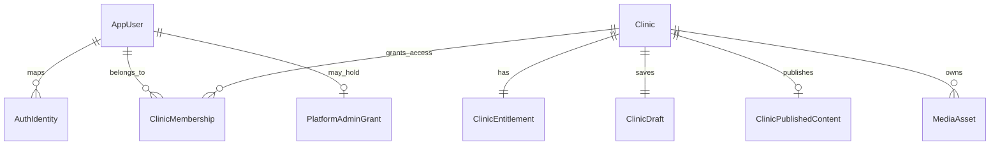

# Ayadatak P4.1 — Database, publication, and authorization design

**Status:** P4.1 general direction owner-approved. P4.3 has a locally validated [Prisma schema](../prisma/schema.prisma); the [P4.4 initial migration](../prisma/migrations/20261029000000_initial_schema/migration.sql) was applied and verified on the owner-confirmed **Ayadatak development database only** on 2026-10-29. P4.5 has an internal, unexposed data-access/validation foundation; authenticated application persistence, public routing, and publishing are not implemented. **Reviewed:** 2026-10-29. [TASKS.md](TASKS.md) is the live progress record. The earlier Supabase recommendation in [IMPLEMENTATION_PLAN.md](IMPLEMENTATION_PLAN.md) is historical; [DECISIONS.md](DECISIONS.md) records the cost-driven provisional change.

## 1. Executive overview

Use a single PostgreSQL database for a modular Next.js application. A relational core owns users, clinic memberships, per-clinic entitlements, publication state, and media ownership. Keep the existing, typed `ClinicContent` shape as **validated, schema-versioned JSONB** in one private mutable draft per clinic and one separately stored current public content row per clinic. An explicit publication transaction replaces the current public row atomically; ordinary Save only updates the draft. This minimizes editor mapping and table count while preserving a hard public/private query boundary. It is not a generic unvalidated JSON dump: server validation, identity/tenant checks, content schema versions, and relational constraints are mandatory.

Neon PostgreSQL + Prisma is the preferred *provisional* technical direction; Railway remains the planned app host. Neon Managed Better Auth and Neon Object Storage are candidates, not adopted dependencies. All security decisions remain in Ayadatak's server-side application layer even if a provider offers RLS or file access controls.

## 2. Scope, verified baseline, and assumptions

- Current [type contract](../src/types/clinic.ts) is a fixed-template `ClinicContent` tree. [ClinicTemplate](../src/components/clinic/clinic-template.tsx) consumes that tree, not database entities. The [visual editor](../src/components/dashboard/visual-website-editor.tsx) has a working copy and a last-saved browser-local copy. [Prototype persistence](../src/lib/dashboard-prototype.ts) uses versioned `localStorage`; `/dashboard-demo?preview=1` renders that saved copy, while `/demo` reads fictional fixtures. No login, persistent tenant data, authenticated preview, publication, or production routing exists.
- V1 has one template, one primary location, one owner-manageable clinic or many clinics per user, and no patients, booking, diagnoses, records, prescriptions, or custom domains. Approved product behavior is in [PRODUCT_SPEC.md](PRODUCT_SPEC.md); P3 template approval is still pending.
- The `ClinicContent` arrays are modest in size and displayed as whole sections. There is no V1 cross-clinic content search or reporting requirement. Limits, cleanup retention, pilot duration, and commercial pricing remain open; the seven-day post-expiration grace and reminder timing are now approved.
- `Clinic.id` and `Clinic.slug` are authoritative relational fields. The matching `identity.id` and `identity.slug` in each JSON document are copied from that row, validated on write, and never trusted as authorization or hostname input. A slug change after publication needs a separate approved policy.
- Draft preview is authenticated and uses the **saved** draft. Unsaved browser changes remain editor-only. Public pages read only current published content when the clinic is public under the chosen entitlement policy.

## 3. Technology decisions and validation gates

- **PostgreSQL:** required relational constraints and transactions. **Neon:** owner-created development project; pooled and direct `SELECT 1` checks passed in P4.3, and the initial development schema was applied in P4.4. **Prisma:** pinned ORM/CLI/Neon adapter 7.10.1; the actual schema was formatted, validated and generated locally. [prisma.config.ts](../prisma.config.ts) uses the direct URL for CLI; [server client](../src/lib/server/prisma.ts) uses the pooled URL. The design sketch below remains illustrative; the actual file is the P4.3 source of truth ([Prisma v7 data sources](https://www.prisma.io/docs/orm/v7/prisma-schema/overview/data-sources), [Prisma config reference](https://www.prisma.io/docs/orm/v7/reference/prisma-config-reference)).
- **Neon Auth candidate:** current Managed Better Auth documentation supports Google OAuth and email/password, with users/sessions in `neon_auth`; Google shared credentials are for development, while production needs owner-controlled OAuth credentials and trusted domains. Neon currently says Auth is available in AWS regions, not Azure or IP Allow/private-network projects ([overview](https://neon.com/docs/auth/about), [OAuth setup](https://neon.com/docs/auth/guides/setup-oauth)). P5 must test email verification/recovery, server session verification, linking, branch URLs, region availability, and deployment domains. The older Stack Auth-based “Neon Auth” docs are not the proposed integration.
- **Neon Object Storage candidate:** current docs describe S3-style access, private or `public_read` **bucket-level** access, presigned URLs, and a supported subset of S3 operations; S3 ACL/policy mutation is not supported ([overview](https://neon.com/docs/storage/overview), [buckets](https://neon.com/docs/storage/buckets)). P9 must test upload/serve/cleanup, region, image delivery, and limits. Store provider-neutral object references so another S3-compatible service can replace it.
- **Cost target:** $0 additional fixed database/auth/storage subscriptions during local development **within free-tier limits**, not guaranteed $0 usage. Neon currently advertises Free at 100 CU-hours and 1 GB PostgreSQL storage per project, 5 GB Object Storage, and Managed Better Auth; its [Auth documentation](https://neon.com/docs/auth/about) lists up to 60,000 MAU on Free. These figures and any egress, backup, restore, region, and paid-tier terms must be rechecked in the console before P4.2 and before launch ([current pricing](https://neon.com/pricing)). No project, billing plan, or production subscription is authorized by this proposal.

## 4. Entity relationship diagram



The diagram omits audit foreign keys (`grantedById`, `updatedById`, `publishedById`, `uploadedById`) for readability. Each is a nullable reference to `AppUser`; it never substitutes for authorization.

## 5. Required V1 entities, constraints, and deletion

1. **`AppUser`** — internal UUID, creation/update timestamps. No password, session, or provider profile copy. Identity comes from `AuthIdentity`; user deletion is blocked while memberships or authored records need retention, pending a privacy policy.
2. **`AuthIdentity`** — internal UUID, `userId` FK, provider namespace and immutable provider subject, `UNIQUE(provider, subject)`, index `userId`. Many identities may map to one user only after a verified linking flow. A provider's email is not a linking key. Auth provider migration adds identities rather than rewriting clinic ownership.
3. **`Clinic`** — UUID, normalized lowercase ASCII slug (unique), operational state `ACTIVE|SUSPENDED`, publication state `NEVER_PUBLISHED|PUBLISHED|UNPUBLISHED`, timestamps. Unique slug index is the creation race arbiter. No hard deletion in V1; suspend/unpublish instead. Do not put a per-clinic database/schema here: one shared DB and explicit `clinicId` scoping.
4. **`ClinicMembership`** — UUID, `clinicId`/`userId` FKs, role `OWNER|MEMBER`, timestamps, `UNIQUE(clinicId,userId)`, `userId` index. V1 grants ownership through this table; `MEMBER` is reserved until its permissions are specified. Owner-only membership/ownership mutations; no self-grant. Enforce **at least one owner** in transactional application workflows (a simple FK/unique index cannot express it). FKs restrict hard deletion.
5. **`ClinicEntitlement`** — one row per clinic (`clinicId` PK/FK), source `PILOT|COMMERCIAL`, start and `endsAt` timestamps, `termVersion`, optional `accessExtendedUntil`, `extensionGrantedAt`, `extensionGrantedById`, original pilot grantor, and timestamps. The row is independent for every clinic. The effective `ACTIVE|EXPIRED|SUSPENDED` label is **derived at read time**, not an additional mutable entitlement status. A pilot grant is not a payment. No price, invoice, payment secret, or ledger here. FK restricts clinic deletion. A current extension plus actor/time is enough for V1; P12 must add an append-only admin audit record before allowing repeated extension changes or revocations, rather than a billing ledger now.
6. **`ClinicDraft`** — one row per clinic (`clinicId` PK/FK), full validated `ClinicContent` JSONB, `schemaVersion`, monotonic `version`, last-saved time, optional updater. Only authenticated authorized routes read/write it. Optimistic compare-and-swap prevents silent overwrite; stable item IDs and `displayOrder` remain in content. FK restricts deletion.
7. **`ClinicPublishedContent`** — zero or one row per clinic (`clinicId` PK/FK), full validated public `ClinicContent` JSONB, schema version, source draft version, monotonic publication number, published timestamp and optional publisher. Only explicit publication changes it. Public routes must never query `ClinicDraft`; private draft routes must never serve public cache entries. A failed DB transaction leaves this row unchanged. There is no complete revision archive or one-click rollback in V1; restoring an erroneous *successful* publication requires an authorized new draft/publish or a tested backup restore. FK restricts deletion.
8. **`MediaAsset`** — UUID, `clinicId` FK, provider/bucket/object key, MIME type, byte size, `PRIVATE_STAGED|PUBLIC_READY` state, uploader, timestamps, unique `(provider,bucket,objectKey)`, `clinicId` index. Store no binary in Postgres. Asset use is validated against clinic ownership; JSON media references are not FKs, so cleanup must inspect both draft and published references. No automatic hard delete until retention and reconciliation are proven. FK restricts clinic deletion.
9. **`PlatformAdminGrant`** — `userId` PK/FK, grant timestamp and grantor. Membership does not confer platform administration, and platform administrators are provisioned only through a separately protected operational workflow. FK restricts deletion; revoke the grant explicitly.

**Deferred:** billing/subscription-event and invoice entities (P13), custom-domain mapping and verification (post-V1), full publication-revision history/rollback UI, content search indexes, patient/booking tables (out of scope). Add a billing entity only when the payment provider and commercial rules are approved. Audit logging and deletion/retention policy need implementation review before production; the nullable actor FKs above do not constitute a complete audit trail.

## 6. Exact `ClinicContent` mapping and representation choice

Both `ClinicDraft.content` and `ClinicPublishedContent.content` store the **same current TypeScript shape**, subject to validation. PostgreSQL `JSONB` is appropriate for these bounded, whole-page reads; keep ownership, lifecycle, entitlements, and asset inventory relational. Moving services, doctors, FAQ, hours, etc. to individual draft tables would require multi-table copy/snapshot logic and more editor mapping without a V1 query requirement. If future search/reporting warrants normalization, add projections or migrate particular groups then. This design does not rely on querying arbitrary JSON paths for authorization.

- **Identity/About:** `identity.id` and `identity.slug` mirror `Clinic.id/slug` and must match them; `nameAr`, optional `tagline`, `about`, optional `logo {src,alt}`, optional `brandColors.primary` and optional legacy `accent` remain in JSON. V1 editing exposes the primary color; `accent` exists in the current contract/fixture but is not a second approved customization control. About text is `identity.about`. There is **no separate About image field** today; template imagery is derived from existing clinic/hero imagery.
- **Hero:** `hero.headline`, `hero.description`, ordered `slides[]` with stable `id` and `image {src,alt}`. Editor rules currently allow 1–5 slides. Array order is authoritative; no separate image-order column. There is **no configurable Hero CTA field** in `ClinicContent`; current template actions derive from supported contact/section content. Do not invent booking or a CTA setting.
- **Services:** each `services[]` item retains `id`, `name`, optional `description`, optional `image {src,alt}`, optional `icon`, and `displayOrder`. **Doctors:** each `doctors[]` item retains `id`, `name`, `specialty`, optional `biography`, optional `yearsOfExperience`, optional `image`, and `displayOrder`. Validate unique item IDs and deterministic display order within each group.
- **Testimonials:** each `testimonials[]` item retains `id`, `displayName`, `text`, `displayOrder`. The only current visibility control is section-wide `sectionVisibility.testimonials`; there is no per-testimonial visibility flag. This is content for real clinic owners, not fabricated marketing claims.
- **FAQ:** each `faq[]` item retains `id`, `question`, `answer`, `displayOrder`.
- **Working hours:** each `workingHours[]` entry retains one of seven `day` values, `isOpen`, and ordered `periods[]` of `opensAt`/`closesAt`. Validate at most one entry per day, time format, open-before-close, no overlap, and closed days with no active periods at publish time.
- **Contact/location:** `contact.phone`, optional `whatsapp`, optional `email`; `location.address`, optional `mapUrl`. **Coordinates are absent** from the current model and are not added. One primary location only.
- **Social links:** `socialLinks[]` of `platform` (`facebook|instagram|x|youtube|linkedin|tiktok`) and `url`; validate schemes/hosts as appropriate. **Section visibility:** preserve all nine booleans (`about`, `services`, `doctors`, `testimonials`, `faq`, `location`, `workingHours`, `contact`, `socialLinks`). Hiding a section never erases its content. Hero is not optional in the present type.
- **Images in JSON:** `ClinicImage.src` remains a string for `ClinicTemplate`. Production persistence should use a stable logical reference such as `media:<UUID>` for uploaded assets; a server adapter resolves it to a permitted delivery URL before rendering. Existing fictional fixture URLs and local editor URLs remain valid in their separate demo/prototype paths. `alt` remains content, not media metadata. Do not let the client supply a foreign clinic's `media:<UUID>` or arbitrary upload key.

Use a versioned runtime validator at the server boundary, plus explicit draft-vs-publish validation. A draft may be incomplete enough to continue editing, but must still have a valid shape, safe text/URLs, bounded arrays and string lengths; publishing adds required-content and ready-media checks. Schema migrations of JSON documents must preserve both stored draft and public content. No actual validator or schema has been installed in P4.1.

## 7. Draft, preview, publication, and concurrency

```text
editor working copy --Save--> ClinicDraft (private, version + 1)
                                      |-- authenticated preview --> ClinicTemplate
                                      |-- explicit Publish --> validate + DB transaction
                                                               |
                                                               v
                                                ClinicPublishedContent (public only)
```

Saving `مركز النور الطبي` over a draft while published `عيادة النور` exists changes only `ClinicDraft`; the public query still returns `عيادة النور`. The authenticated preview renders the newly saved draft. Only a successful explicit `نشر التعديلات` transaction replaces the public row. First publication uses `نشر الموقع` and changes publication state from `NEVER_PUBLISHED` to `PUBLISHED`. An authorized unpublish changes only publication state, retaining content for later controlled republish. Suspension is separate from publication state.

- **Save:** authenticated member with edit permission; load clinic and membership server-side; validate `clinicId`, `identity.id/slug`, document version and media ownership. `UPDATE ClinicDraft ... WHERE clinicId=? AND version=?` increments version or returns conflict. On first clinic creation, create clinic, owner membership, pilot entitlement if granted, and initial draft in one transaction. Never alter `ClinicPublishedContent` on Save.
- **Publish:** require owner/publish permission, active clinic, valid entitlement, explicit expected saved-draft version, publishable content and ready media. Inside one transaction, lock the `Clinic` row **then** its `ClinicDraft` row in that fixed order (or use a proven equivalent compare-and-swap); re-read membership, entitlement, draft version, and current publication number. Reject stale expected versions/numbers. Upsert the complete public JSON document, increment publication number, and set publication state before commit. A transaction rollback leaves the previous public row and state intact. A retry with the same expected version must be idempotent or return a clear conflict; do not silently overwrite a newer publication. P4.3/P10 tests must prove the locking behavior against the chosen Prisma/Neon connection mode.
- **External media/cache boundary:** staging-to-public object preparation is outside the DB transaction and may leave an orphan if the transaction fails; it must never alter the current published object. After the copy succeeds, update the relevant `MediaAsset` bucket/key/state **in the same DB transaction** as the published content pointer/row so a committed public document resolves only ready assets. On transaction failure, the old media row and old public content remain; clean the unreferenced public copy later. After commit, invalidate/revalidate the clinic's public page/metadata cache. Cache invalidation is **not** part of the DB transaction and can fail; retry it and bound TTL, so old public content may temporarily remain visible but no draft or half-published document is served. Do not delete media referenced by current published content. Full rollback history is deferred; backups are not a substitute for the publication boundary.
- **Changes indicator:** compare `ClinicDraft.version` with `ClinicPublishedContent.sourceDraftVersion`; absence of a publication means never published. A saved draft version newer than the source version means unpublished saved changes. An unsaved editor working copy uses a separate client-side dirty indicator.

## 8. Membership, entitlement, and security boundaries

The trust boundary is the verified server session, then an internal `AppUser` identity mapping, then `ClinicMembership` for the requested clinic. A browser-supplied clinic ID is only a selector, never proof of access. Every private read/write, image operation, publication, membership change, and entitlement change must authorize on the server. Use clinic-scoped `WHERE clinicId = ...` operations and check affected row counts; avoid unscoped `findUnique(id)` followed by an unguarded write. Public routes perform a separate slug lookup and use **only** `ClinicPublishedContent` when active/published/eligible. Do not load a draft and filter fields afterward.

`OWNER` may edit, preview, publish, and manage clinic membership, subject to explicit role rules. `MEMBER` has no assumed production permission until P7 defines it; deny by default. `PlatformAdminGrant` authorizes separately protected oversight/entitlement actions, not automatic reading of every private draft or impersonation. The database connection identifies the application service, **not** the end user. Prisma does not automatically apply per-user authorization or RLS, even when Neon Auth stores identities in the same database. Use least-privilege DB credentials; if RLS is added, test it with the exact connection role and transaction context rather than treating it as implicit protection.

### Approved expiration, grace, and extension rule

Entitlement lookup is per clinic. Store the subscription/pilot period's `endsAt` as a UTC instant and derive `graceEndsAt = endsAt + exactly 7 × 24 hours` rather than persisting a second mutable deadline. If an authorized platform administrator grants an extension, store `accessExtendedUntil` as a UTC **exclusive** deadline, plus who granted it and when. For a date selected in the admin UI, convert the end of that date in the explicitly chosen clinic/business timezone to the next local midnight UTC instant; show the converted deadline for confirmation. Validate that a new extension is in the future and does not accidentally shorten existing effective access. `effectiveAccessUntil = max(graceEndsAt, accessExtendedUntil ?? graceEndsAt)`. A renewal updates `endsAt` and increments `termVersion` transactionally; an old extension may remain for audit/context but has no effect once the renewed deadline is later. Neither expiry nor renewal deletes content, images, draft, or published data. No 30-day read-only period or permanent free public tier follows the deadline.

`Clinic.operationalState = SUSPENDED` is the independent administrative security/policy override. Check it **before** entitlement timing: grace and extensions can never bypass suspension. The earlier proposed persisted `EntitlementStatus ACTIVE|EXPIRED|SUSPENDED` is removed to avoid a row saying `EXPIRED` while grace/extension grants access or `ACTIVE` after the deadline. Derive two display values instead: the **subscription term** is current before `endsAt` and expired at/after it; **public access** is normal before `endsAt`, grace before `graceEndsAt`, extended before `accessExtendedUntil` if that is later, unavailable after the effective deadline, or administratively suspended regardless of dates. A missing entitlement fails closed. Public availability also requires `Clinic.publicationState = PUBLISHED` and an existing `ClinicPublishedContent` row. Renewing or extending an expired clinic restores its existing published site without recreation after cache revalidation; it does not auto-publish new drafts. Publication during grace/extension remains a policy gate for implementation review; do not silently infer it from public-read eligibility.

Send renewal reminders at `endsAt - 7 days` and `endsAt - 1 day`, subject to a valid contact destination and the eventual notification policy. Do not implement email delivery now. A future small `EntitlementReminderDelivery` ledger should use `UNIQUE(clinicId, termVersion, reminderKind)` with send status/attempt timestamps; this prevents duplicate reminders across retries and renewed terms. The scheduler must recheck the current `termVersion` and `endsAt` before sending. This deferred ledger does not change the nine-entity P4.1 core. A grantor must hold a current platform-admin grant. No user-wide “plan” unlocks a second clinic; commercial billing events belong to P13.

P12's private Super Admin dashboard is planned to list clinics/users, owner memberships, publication and entitlement state, perform suspend/reactivate and pilot grants, set an arbitrary validated future extension date, and show meaningful operational health. It requires separate server-verified `PlatformAdminGrant` authorization and audit, no public signup, unrestricted impersonation, automatic access to private drafts, or fake analytics. The admin sees entitlement/publication summaries by default; support access to private clinic data needs a separate explicit policy. No P12 UI is built in P4.2.

## 9. Auth and media integration boundaries

The auth adapter verifies the provider session on the server and resolves `(provider, subject)` to `AppUser`; it does not trust client-supplied email/user IDs. Google and email sign-ins for one person must be linked only through a verified, explicit account-linking process. A matching email string alone cannot merge accounts. Neon Auth's own `neon_auth` tables are provider-managed and **not** modeled or migrated by the proposed Prisma app schema; if the auth provider changes, add/verify new `AuthIdentity` mappings. P5 decides email/password vs email link, verification, recovery, and cookie/subdomain strategy.

For media, authorize upload/delete by membership and clinic scope; generate unpredictable clinic-prefixed object keys on the server; allowlist image MIME and inspect actual bytes; cap size/count/dimensions; strip risky metadata and produce optimized variants where needed. Values remain policy gates for P9 rather than invented constants here. Private staged objects must not be publicly readable. A public, immutable rendition can be prepared before publication; the published document should resolve only ready renditions. Neon bucket-level `public_read` means private drafts and public assets need separate buckets/prefix delivery architecture, not per-object ACL assumptions. File replacement creates a new asset/key, never overwrites a published object. Garbage collection must examine current draft and publication references, allow for in-flight publishing, respect retention, and tolerate cross-service failures. For few clinics, conservative retention is cheaper and safer than premature automated deletion.

## 10. Slugs, tenant routing, and unknown sites

[Current fixture resolver](../src/lib/clinic-resolver.ts) trims/lowercases slugs; its regex permits 1–63 lowercase ASCII alphanumeric/hyphen characters, requires alphanumeric first/last, and rejects `admin`, `app`, `api`, `dashboard`, `billing`, `auth`, `mail`, `static`, `help`, `www`. Production creation must repeat normalization and reserved-name validation **server-side**, then rely on the database unique slug constraint to resolve concurrent duplicate attempts. Case-sensitive `UNIQUE` is sufficient only because all writes are normalized; add a DB lowercase/format constraint or normalized generated column in the migration so bypass writes cannot violate this assumption. Reserved names belong in server policy with tests and, if practical, a DB guard/check; updates must use the same path. A conflicting unique insert returns a friendly “slug taken” result.

Only expected `{slug}.ayadatak.com` hostnames are considered for V1; validate the full host before lookup, not an arbitrary `Host` suffix or client clinic ID. Unknown, invalid, reserved, never-published, explicitly unpublished, and suspended clinics return a non-indexable not-found response (or an approved suspension page) without draft details. Future custom domains require a separate verified-domain table and proof-of-control; no domain or SSL automation is designed for V1.

## 11. Conceptual data access contracts

- `getClinicBySlug(hostSlug)`: public, normalized/validated slug; one scoped clinic lookup, no private content; unknown/invalid/suspended/unpublished result is non-public. `getPublishedClinicContent(clinicId)`: public **only after** route/lifecycle/entitlement checks; select current public row and resolve ready media; missing row fails closed.
- `getAuthorizedClinicDraft(session, clinicId)`: verified session → `AppUser` → membership/role → clinic-scoped draft; no membership returns not-found/forbidden without revealing content. Preview uses this saved draft and no public cache.
- `updateClinicDraft(session, clinicId, expectedVersion, content)`: authenticated edit permission; check authoritative identity/slug and owned media; validate; compare-and-swap save; return new version or conflict/validation/forbidden.
- `publishClinicDraft(session, clinicId, expectedDraftVersion, expectedPublicationNumber)`: authenticated publish permission, non-suspended clinic and approved publication entitlement rule; validate saved draft/media; transactionally update public row/state; return publication number/time or conflict/validation/entitlement error. Do not accept an arbitrary client-supplied content blob as the publication source.
- `createClinic(session, normalizedSlug, initialContent)`: verified user and onboarding policy; server rejects reserved/invalid slug; transaction creates clinic, owner membership, initial draft and authorized pilot entitlement if granted; unique conflict is handled. No automatic publish.
- `listUserClinics(session)`: memberships filtered by internal user ID; fetch only those clinics and their own entitlement/publication summaries, with bounded pagination. `getClinicEntitlement(session, clinicId)`: owner or platform-admin authorization for private detail; compute term/access states from one clock instant and the clinic override. Admin extension/renewal writes must be transactional, authorized, and cache-invalidating. Membership/entitlement edits require separate elevated services, not ordinary content endpoints.

## 12. Performance, operations, and cost discipline

- Use one shared database/project for all clinics. Index slug, membership uniqueness/user lookup, and media by clinic; primary-key clinic lookups cover draft/publication/entitlement. No JSON GIN index until a real query requires it. Cap pagination and content/image counts.
- Keep a process-scoped Prisma client on the server. Use Neon's pooled connection for runtime and a migration-safe connection/config for CLI according to the **pinned** Prisma version and its current Neon guide; avoid one connection per request, and test cold-start/interactive-transaction behavior ([Prisma Neon guide](https://www.prisma.io/docs/orm/v6/overview/databases/neon)). Prisma v7 moved URL config out of the schema; P4.3 must confirm exact adapter/migration setup. Do not run schema generation and Next production build concurrently in this repo.
- Public pages should cache the already assembled **published** content by clinic/version, with bounded TTL and post-commit revalidation; do not cache authorized drafts in a shared public key. Reads should avoid repeated authorization/entitlement/media queries where a single scoped query and memoized projection suffice. Autosuspend may add cold-start latency; measure before buying always-on compute.
- Before production, define backup/restore cadence and rehearse a restore, especially publication and image-reference recovery. Neon's Free restore/history window and snapshot limits are not a durable independent backup plan; check current terms. Track database size, CU-hours, object bytes/egress and MAU against current limits. Do not introduce Redis, a queue, workers, or a second service without observed need. P4 covers schema and access; P9 covers media; P10 publication/routing; P11 cache/SEO; P13 billing.
- V1 stores business content and user account linkage, not clinical patient data. Limit access, encrypt transport, protect secrets, define retention/export/deletion policy, and avoid logging private drafts or credentials. This proposal makes no claim of formal medical/privacy regulatory compliance.

## 13. Non-runtime Prisma ORM v7 schema sketch

This original design sketch is retained for architecture context. The authoritative executable model is now [prisma/schema.prisma](../prisma/schema.prisma), locally validated with Prisma 7.10.1 and migrated to the development database only. It removes the sketch's unsafe default `OWNER` membership role (callers must choose explicitly) and uses PostgreSQL `timestamptz` for UTC instants. [prisma.config.ts](../prisma.config.ts) loads ignored `.env.local` and carries the direct CLI URL; the server-only runtime adapter uses the pooled URL. The [P4.4 migration](../prisma/migrations/20261029000000_initial_schema/migration.sql) contains database-level slug format, term-date, positive-number, JSON-object-root, and extension co-presence checks. Publication-state/current-public-row consistency is cross-table and still needs an application transaction (or a separately reviewed trigger). The at-least-one-owner invariant, tenant authorization, publishing permission, and full JSON `ClinicContent` validation likewise need server workflows/tests; Prisma schema validation does not enforce them.

```prisma
generator client {
  provider = "prisma-client"
  output   = "../src/generated/prisma"
}

datasource db {
  provider = "postgresql"
}

enum ClinicOperationalState {
  ACTIVE
  SUSPENDED
}

enum ClinicPublicationState {
  NEVER_PUBLISHED
  PUBLISHED
  UNPUBLISHED
}

enum ClinicRole {
  OWNER
  MEMBER
}

enum EntitlementSource {
  PILOT
  COMMERCIAL
}

enum MediaState {
  PRIVATE_STAGED
  PUBLIC_READY
}

model AppUser {
  id                 String               @id @default(uuid()) @db.Uuid
  createdAt          DateTime             @default(now())
  updatedAt          DateTime             @updatedAt
  identities         AuthIdentity[]
  memberships        ClinicMembership[]
  entitlementGrants  ClinicEntitlement[]  @relation("EntitlementGrantor")
  accessExtensions   ClinicEntitlement[]  @relation("ExtensionGrantor")
  updatedDrafts      ClinicDraft[]        @relation("DraftUpdater")
  publications       ClinicPublishedContent[] @relation("Publisher")
  uploads            MediaAsset[]         @relation("Uploader")
  adminGrant         PlatformAdminGrant?  @relation("AdminSubject")
  adminGrantsIssued  PlatformAdminGrant[] @relation("AdminGrantor")
}

model AuthIdentity {
  id         String   @id @default(uuid()) @db.Uuid
  userId     String   @db.Uuid
  provider   String
  subject    String
  createdAt  DateTime @default(now())
  user       AppUser  @relation(fields: [userId], references: [id], onDelete: Restrict)
  @@unique([provider, subject])
  @@index([userId])
}

model Clinic {
  id                 String                 @id @default(uuid()) @db.Uuid
  slug               String                 @unique @db.VarChar(63)
  operationalState   ClinicOperationalState @default(ACTIVE)
  publicationState   ClinicPublicationState @default(NEVER_PUBLISHED)
  createdAt          DateTime               @default(now())
  updatedAt          DateTime               @updatedAt
  memberships        ClinicMembership[]
  entitlement        ClinicEntitlement?
  draft              ClinicDraft?
  published          ClinicPublishedContent?
  media              MediaAsset[]
}

model ClinicMembership {
  id         String     @id @default(uuid()) @db.Uuid
  clinicId   String     @db.Uuid
  userId     String     @db.Uuid
  role       ClinicRole
  createdAt  DateTime   @default(now())
  clinic     Clinic     @relation(fields: [clinicId], references: [id], onDelete: Restrict)
  user       AppUser    @relation(fields: [userId], references: [id], onDelete: Restrict)
  @@unique([clinicId, userId])
  @@index([userId])
}

model ClinicEntitlement {
  clinicId              String            @id @db.Uuid
  source                EntitlementSource
  startsAt              DateTime          @default(now())
  endsAt                DateTime
  termVersion           Int               @default(1)
  accessExtendedUntil   DateTime?
  extensionGrantedAt    DateTime?
  extensionGrantedById  String?           @db.Uuid
  grantedById           String?           @db.Uuid
  createdAt             DateTime          @default(now())
  updatedAt             DateTime          @updatedAt
  clinic                Clinic            @relation(fields: [clinicId], references: [id], onDelete: Restrict)
  grantedBy             AppUser?          @relation("EntitlementGrantor", fields: [grantedById], references: [id], onDelete: Restrict)
  extensionGrantedBy    AppUser?          @relation("ExtensionGrantor", fields: [extensionGrantedById], references: [id], onDelete: Restrict)
  @@index([endsAt])
}

model ClinicDraft {
  clinicId      String   @id @db.Uuid
  content       Json
  schemaVersion Int
  version       Int      @default(1)
  savedAt       DateTime @default(now())
  updatedById   String?  @db.Uuid
  clinic        Clinic   @relation(fields: [clinicId], references: [id], onDelete: Restrict)
  updatedBy     AppUser? @relation("DraftUpdater", fields: [updatedById], references: [id], onDelete: SetNull)
}

model ClinicPublishedContent {
  clinicId           String   @id @db.Uuid
  content            Json
  schemaVersion      Int
  sourceDraftVersion Int
  publicationNumber  Int
  publishedAt        DateTime @default(now())
  publishedById      String?  @db.Uuid
  clinic             Clinic   @relation(fields: [clinicId], references: [id], onDelete: Restrict)
  publishedBy        AppUser? @relation("Publisher", fields: [publishedById], references: [id], onDelete: SetNull)
}

model MediaAsset {
  id            String     @id @default(uuid()) @db.Uuid
  clinicId      String     @db.Uuid
  provider      String
  bucket        String
  objectKey     String
  mimeType      String
  byteSize      Int
  state         MediaState @default(PRIVATE_STAGED)
  uploadedById  String?    @db.Uuid
  createdAt     DateTime   @default(now())
  clinic        Clinic     @relation(fields: [clinicId], references: [id], onDelete: Restrict)
  uploadedBy    AppUser?   @relation("Uploader", fields: [uploadedById], references: [id], onDelete: SetNull)
  @@unique([provider, bucket, objectKey])
  @@index([clinicId])
}

model PlatformAdminGrant {
  userId       String   @id @db.Uuid
  grantedAt    DateTime @default(now())
  grantedById  String?  @db.Uuid
  user         AppUser  @relation("AdminSubject", fields: [userId], references: [id], onDelete: Restrict)
  grantedBy    AppUser? @relation("AdminGrantor", fields: [grantedById], references: [id], onDelete: Restrict)
}
```

## 14. Alternatives and open decisions

- **Many relational content tables + published snapshot:** useful for independent queries and DB-level field constraints, but adds many writes and mapping layers for a fixed V1 template. Revisit if content search/reporting emerges. **Generic revision ledger:** supports rollback/history, but costs more storage, joins, retention and concurrency logic; not required to preserve the *current* public row on failed publication. **Single mutable document for draft and public:** rejected because Save would risk publishing and public reads could leak drafts.
- **Supabase bundle:** remains a technically viable historical proposal, but the owner's provisional cost preference is Neon; neither provider is deployed. **Provider-specific auth/storage schema:** rejected because provider portability and server authorization boundaries matter more than a nominally unified backend.
- **Remaining implementation decisions:** whether to retain a previous successful publication for one-click rollback; exact publishable minimum/content size limits; `MEMBER` role permissions; pilot duration/clinic count; whether publishing edits is allowed during grace/extension; extension timezone and operational audit details; slug rename/redirect policy; deletion/retention/backups; email mechanism/linking in P5; storage limits and final provider in P9. Public access through exactly seven days of grace, the renewal reminders, and admin extension/suspension precedence are approved, not open. Any inability to satisfy region/cost/auth/storage needs may change the provider choice without changing tenant/content fundamentals.

## 15. Acceptance gates for P4.2–P4.5

- The owner approved the general P4.1 direction and expiration policy. The owner created the development-only Neon project in P4.2; P4.3 verified both connections read-only and validated a nine-entity Prisma schema locally. The owner separately approved the P4.4 initial **development** migration, now applied. No production integration or migration is approved. Check current Free limits, region, Auth/Storage feasibility, and backup/restore assumptions before launch.
- P4.3 pinned Prisma, validated and generated the executable schema, and verified pooled/direct development connections with `SELECT 1`; it made no database write. P4.4 generated the SQL offline and, after a separate owner authorization and fresh empty-target preflight, applied the single initial migration to `neondb/public` on the owner-confirmed `ayadatak-dev` development-only project. Production migration requires its own approval.
- The original roadmap's server-scoped data access, content validation, cross-clinic denial, optimistic concurrency, suspension, and media-ownership tests now have a P4.5 **internal foundation** (see §17). Real authentication, publication-failure transaction tests, public routing, and HTTP integration remain unimplemented. No public draft access may be introduced.
- P5/P9/P10/P11 provide authentication, media, publication/routing, and cache/SEO respectively. Production migrations/deployment and commercial billing remain separate approval gates.

## 16. P4.4 initial SQL migration — applied to development only

The file at [`prisma/migrations/20261029000000_initial_schema/migration.sql`](../prisma/migrations/20261029000000_initial_schema/migration.sql) was generated offline with installed Prisma 7.10.1 using `prisma migrate diff --from-empty --to-schema prisma/schema.prisma --script --output ...`. [`migration_lock.toml`](../prisma/migrations/migration_lock.toml) pins the PostgreSQL migration provider. This is a **new-empty-schema migration**, not a baseline marked as already applied; `migrate resolve --applied`, `migrate dev`, `db push`, reset, and seeds were not used. The owner-approved execution used `prisma migrate deploy` against the direct Ayadatak development connection.

The SQL creates the five enums and nine tables in PostgreSQL `public` (explicit `search_path`), with UUID primary keys, required and optional columns, `timestamptz(6)` instants, JSONB draft/public content, unique slug/auth identity/membership/media-object indexes, three supporting user/clinic indexes and one entitlement-expiry index, and 14 foreign keys. Clinic-owned records and privileged grantor references use `ON DELETE RESTRICT`; optional last-editor/publisher/uploader actor references use `ON DELETE SET NULL`. Prisma's `@default(uuid())` and `@updatedAt` values are supplied by the Prisma client, not PostgreSQL defaults; raw SQL writers must supply them explicitly. No triggers, seed data, destructive statements, billing tables, or auth-provider-owned `neon_auth` tables are present.

The hand-reviewed SQL appends ordinary PostgreSQL `CHECK` constraints:

- `Clinic.slug`: lowercase ASCII, length 1–63 through its `VARCHAR(63)` type, alphanumeric first/last, internal hyphens permitted; the existing unique index handles concurrent duplicate creation. A second DB check rejects the current ten reserved names as defense in depth. They remain an application rule in `RESERVED_CLINIC_SLUGS`, tested across the complete list; future changes to that policy must keep the DB guard synchronized. Production onboarding must call the same server-side normalization/reservation rule on **creation and rename**; the fixture resolver is not an authorization or onboarding service.
- `ClinicEntitlement`: `endsAt > startsAt`, `termVersion > 0`, and extension deadline/grant time/grantor all absent or all present with `accessExtendedUntil > extensionGrantedAt`. There is deliberately no `accessExtendedUntil > endsAt` check: a prior extension can remain after renewal. A moving `now()`-based future-date rule, grantor's current admin role, no accidental shortening of effective access, and renewal version increment require server transactions and audit policy.
- `ClinicDraft` and `ClinicPublishedContent`: JSONB root must be an object; schema/draft/publication counters must be positive. Full `ClinicContent` shape, identity/slug equality, media ownership/readiness, monotonic increments, stale-version rejection, and publication atomicity remain server responsibilities.
- `MediaAsset.byteSize > 0`; MIME/actual-byte validation, limits and object-key ownership remain server/storage responsibilities.

**Tenant and publication boundary:** a DB FK proves that referenced clinic/user rows exist, not that the current caller may see or alter them. Future private operations must verify a server session, map the provider identity to `AppUser`, load the selected clinic's `ClinicMembership` and explicit role, scope every draft/media mutation to that `clinicId`, and require owner/publish permission before publishing. `MEMBER` remains deny-by-default until defined. Platform-admin operations must independently check `PlatformAdminGrant` and audit privileged changes; an admin grant does not automatically allow reading private drafts. Public reads must gate on clinic state, per-clinic entitlement, publication state and an existing `ClinicPublishedContent` row, then read **only** that published table. Cross-table requirements (at least one owner, entitlement and draft at onboarding, publication state matching a public row, and published source version matching a saved draft) need transactional application workflows; ordinary `CHECK`/FK constraints cannot enforce them.

**Approved time policy, not yet implemented:** derive `graceEndsAt = endsAt + 7 × 24 hours` and send reminders at `endsAt − 7 days` and `endsAt − 1 day` after validating contact/delivery policy. Public access continues through the seven-day grace, then becomes unavailable at the exclusive deadline unless an authorized administrator has set a later valid `accessExtendedUntil` or the clinic renews. `SUSPENDED` always overrides the time calculation. Renewal or extension can restore the existing public document without publishing drafts; expiration never deletes clinic content or media. An idempotent reminder-delivery ledger and repeated-extension audit are future work, not in this nine-table migration.

**Execution and verification:** the owner confirmed Neon project `ayadatak-dev`, its default-named `production` branch (development-only project), database `neondb`, and schema `public`. Immediately before execution, read-only direct-connection checks verified `neondb/public`, a direct Neon host, no `public` relations, types, routines, extensions, or Prisma migration history. `prisma migrate deploy` then applied only `20261029000000_initial_schema`. Read-only checks found exactly the nine expected application tables plus `_prisma_migrations`, five enums, nine PKs, 14 FKs, four unique and four other non-primary indexes, all ten custom `CHECK` constraints, a finished non-rolled-back migration-history row, and zero application records. Prisma migration status reports no pending migrations. Only the `public` non-system schema and expected objects were observed. This verifies DDL presence, **not** tenant authorization, future transaction logic, or constraint behavior on inserted data. No production or Wanasatna database was touched; future production migration has a separate approval gate.

## 17. P4.5 internal data-access foundation

[`clinic-data-core.ts`](../src/lib/clinic-data-core.ts) defines testable clinic-scoped operations; [`server/clinic-data.ts`](../src/lib/server/clinic-data.ts) is the `server-only` Prisma adapter. No route, Server Action, or client component imports the adapter. The runtime service's actor verifier defaults to **deny all** until P5 integrates a server-verified session. P5 must verify the chosen auth provider's session (Neon Auth remains a candidate), map its immutable `(provider, subject)` to `AuthIdentity`/`AppUser`, then supply an actor-verification capability from that trusted server path. A browser-supplied user ID, clinic ID, role, or platform-admin claim is never proof of permission. Mock actor verification exists only in isolated tests. `OWNER` is the sole currently supported draft role; `MEMBER` and platform admins do not inherit private-draft access. Future membership revocation, entitlement changes, publishing and media mutations require their own elevated services and tests.

Draft reads check owner membership before clinic lookup; the draft query itself also requires current OWNER membership and validates referenced media ownership. Saves check identity `id`/slug against the authoritative `Clinic` row, validate content and owned media, require schema version 1 and an expected positive draft version, and perform a single `updateMany` compare-and-swap on `clinicId`, draft version, schema version **and current OWNER membership**. Successful saves increment `version`, record `savedAt`/`updatedById`, and never update `ClinicPublishedContent`; stale writes return conflict, while revoked membership cannot commit. Onboarding must later create the first draft transactionally with clinic, owner membership and entitlement. This layer does not create clinics or drafts.

[`clinic-content-validation.ts`](../src/lib/clinic-content-validation.ts) validates the existing `ClinicContent` shape, with no new fields. Limits: complete document ≤200,000 UTF-8 bytes; item IDs ≤100 characters; names ≤120; short text/image alt ≤200; long text ≤3,000; Hero headline ≤160 and description ≤600; location address ≤500; phone/WhatsApp ≤32; email ≤254; URLs ≤2,048. Collections are capped at 30 services, 30 doctors, 20 testimonials, 30 FAQs, six social links, seven distinct weekdays, and three ordered/non-overlapping `HH:mm` periods per day. Hero has 1–5 uniquely identified slides. Collection IDs and positive display orders must be unique within each collection; primary/accent colors, when present, use `#RRGGBB`. Image sources accept `media:<UUID>`, safe `/images/` paths, or HTTPS URLs; map/social URLs require HTTPS. URL credentials, ports, fragments, localhost and raw IP hosts are rejected. Drafts may have empty text/image fields while remaining structurally valid. Publishing validation additionally requires clinic name, Hero title/description/image/alt, item names and required text, periods for open days, and content for visible About/Contact/Location sections. It is a validation foundation, not a final P10 publication policy; final publishable minimum and media-delivery rules still need owner review.

[`clinic-entitlement.ts`](../src/lib/clinic-entitlement.ts) evaluates per-clinic UTC instants without background jobs. Suspension wins first; no entitlement fails closed; access starts at `startsAt`, is active strictly before `endsAt`, in grace from `endsAt` up to but excluding `endsAt + 7 × 24 hours`, then extended only until an exclusive later `accessExtendedUntil`; after that it expires. Public reads additionally require `PUBLISHED`, a current published row, supported/valid content, authoritative identity match, and all referenced media owned by that clinic in `PUBLIC_READY` state. They never query drafts. Extension-grant authorization, reminders, billing, publication transactions, cache invalidation, and public subdomain routing are not implemented.
